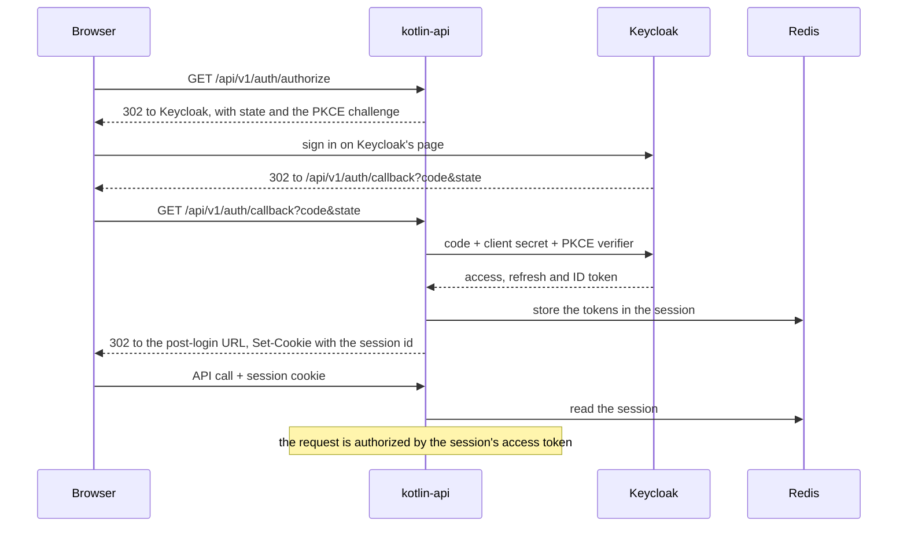

# Authentication

The application never handles a credential. Keycloak (realm `kotlin-api`) owns every page that touches one: sign-up,
sign-in, email verification, password reset, two-factor authentication and acceptance of the terms of use. The
application is a BFF: it runs the sign-in, keeps the tokens on the server and gives the browser only a session cookie.

## Signing in

1. The browser opens `GET /api/v1/auth/authorize`. `HostedSignInRequests` builds the authorization request with PKCE
   and redirects to Keycloak. Optional parameters pass through: `register=true` opens the sign-up page, and `kc_action`
   starts one of `CONFIGURE_TOTP`, `UPDATE_PASSWORD` or `delete_credential:<id>`, with a credential's UUID, which
   Keycloak asks to confirm; any other value is dropped. Keycloak's language is the first of the browser's languages
   the application has (`Language`).
2. Keycloak returns to `GET /api/v1/auth/callback`. Spring Security's OAuth2 client exchanges the code, using the
   confidential client `kotlin-api` and its secret, and stores the tokens in the HTTP session.
3. `SignInCompletion` decodes the access token, mirrors the account into PostgreSQL and redirects to
   `application.auth.post-login-url`. When the account cannot be written, or Keycloak issued no refresh token, it ends
   the Keycloak session again and redirects with `?error=sign_in_failed`; a lost or forged `state` gives
   `?error=state_mismatch`.

The browser holds only the `KOTLIN_API_SESSION` cookie: `HttpOnly`, `SameSite=Lax`, `Secure` outside the local profile.

## Every request is authorized by a token

The back-end is an OAuth2 resource server. It verifies the token's signature against Keycloak's published keys, its
issuer, its expiry and its audience (`kotlin-api`), and takes the roles from `realm_access.roles`, so `ADMIN` in
Keycloak becomes `ROLE_ADMIN` here.

A request carries the token in one of two ways:

| Caller                   | How                                                                                                   |
|--------------------------|-------------------------------------------------------------------------------------------------------|
| A browser with a session | `SessionAccessTokenFilter` takes the access token from the session and authorizes the request with it |
| A client of its own      | `Authorization: Bearer` with a token it obtained from Keycloak itself                                 |

Either way the decision rests on the token alone, not on the session, so any instance can serve any request.

## Sessions and refreshing

The session lives in Redis for ten hours, and its access token is refreshed once per refresh token, across instances:
[Token refresh](mechanisms/token-refresh.md).

## Signing out

`POST /api/v1/auth/logout` revokes the refresh token at Keycloak, which ends the Keycloak session, and invalidates the
local one.

## Cross-site requests

An unsafe request from another site gets no token: [Cross-site requests](mechanisms/cross-site-requests.md).

## The sign-in pages

Keycloak draws the sign-in, sign-up, password reset and second-factor pages, and the mails it sends, with the theme in
[`keycloak/themes/kotlin-api`](../keycloak/themes/kotlin-api), so they carry the API's name and legal pages:

| Part                      | Holds                                                                                 |
|---------------------------|---------------------------------------------------------------------------------------|
| `login/theme.properties`  | extends `keycloak.v2`, whose templates draw every page, and names the legal pages     |
| `login/template.ftl`      | the page frame: a top bar with the name and the menus, a footer with the legal pages  |
| `login/resources`         | `css/app.css`, the colors, type and card on PatternFly; `js/theme.js`, the theme menu |
| `login/messages`          | the texts of the bar and the footer, in Polish and English                            |
| `email/html/template.ftl` | the frame of every mail; its texts stay Keycloak's own                                |

The theme menu offers System, Light and Dark; without a choice the pages follow the reader's system. The choice is kept
in the browser for Keycloak's address. A realm that turns dark mode off gets the light theme and no menu.

`template.ftl` is a copy of `keycloak.v2`'s own, changed only where it says `Changed from keycloak.v2`. Keycloak builds
its pages from that template, so after an upgrade of Keycloak the copy is compared with the new release's and brought up
to date. The Keycloak theme workflow does the comparison: `keycloak/check-template.sh` fails when the template in the
Keycloak image of `docker-compose.local.yml` is not the one the copy was made from, recorded as `parentTemplateSha256`
in `theme.properties`, which changes with the copy. The colors are neutral ones, as the API has no front-end of its own.
A mail's colors are written as hex, since mail clients read neither `oklch()` nor `light-dark()`. The links of the bar
and the footer lead to the client's base URL, `baseUrl` in the realm.

The realm names the theme in `loginTheme` and `emailTheme`. Locally, compose mounts the folder into Keycloak. A Keycloak
that serves several applications, each in its own realm, takes it as a JAR in `/opt/keycloak/providers`:
`keycloak/build-theme.sh` writes `keycloak/target/kotlin-api-keycloak-theme.jar`, and `keycloak/Dockerfile` builds an
image holding it in `/themes`, which the Keycloak theme workflow publishes on a `keycloak-theme-v*` tag.

## Code

| Class                                                           | Role                                                          |
|-----------------------------------------------------------------|---------------------------------------------------------------|
| `config/SecurityConfig`                                         | the filter chain: OAuth2 login, resource server, public paths |
| `auth/AuthConfig`                                               | the client registration and the refresh chain                 |
| `auth/HostedSignInRequests`                                     | the authorization request: PKCE, sign-up, Keycloak actions    |
| `auth/SignInCompletion`                                         | mirroring the account after sign-in, and failed sign-ins      |
| `auth/SessionAccessTokenFilter`                                 | turning a session into a token-authorized request             |
| `auth/SingleFlightRefreshTokenProvider`, `auth/SharedRefreshes` | one refresh per refresh token                                 |
| `auth/KeycloakSessions`                                         | ending the Keycloak session                                   |

`HostedSignInTest`, `KeycloakIdentityTest` and `SharedRefreshesTest` cover the sign-in request, the identity read from a
token and the refresh across instances (on a Redis container).
